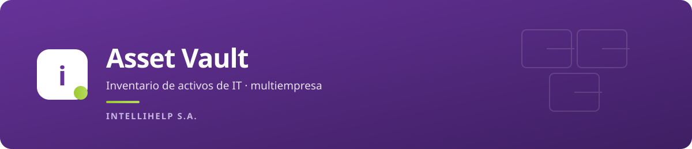
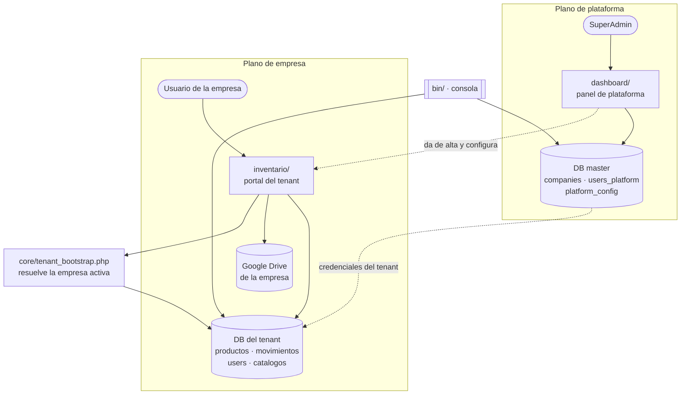
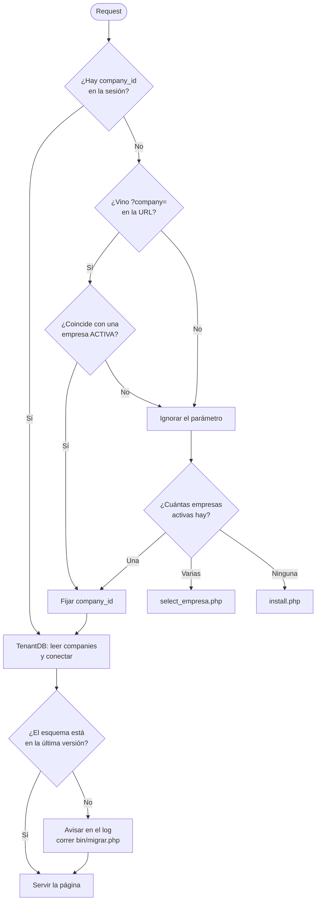
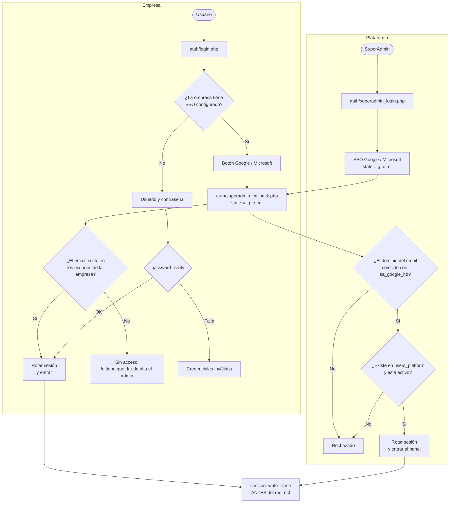
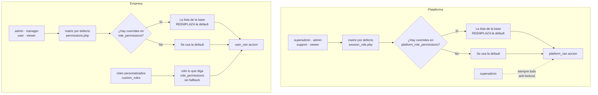
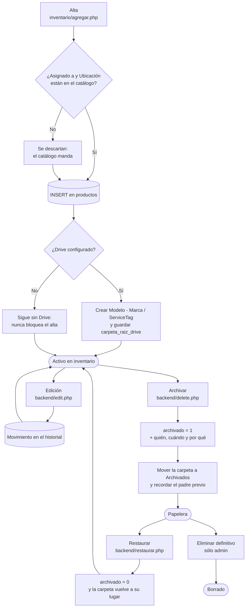
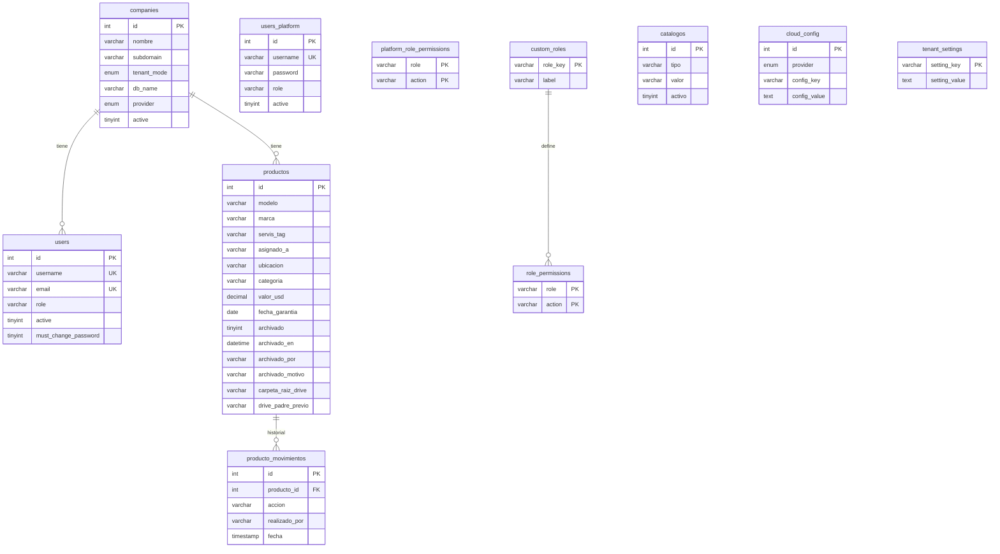
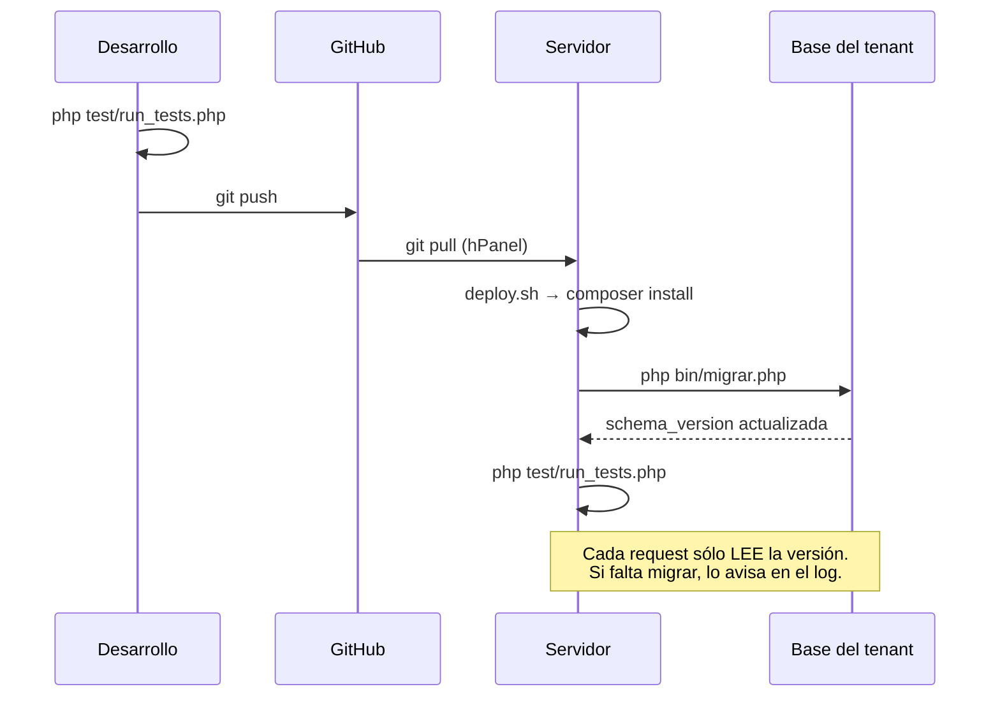

<p align="center">
  
</p>

<p align="center">
  <b>Plataforma SaaS multiempresa de inventario de activos de IT.</b><br>
  Cada empresa cliente tiene su propio portal, sus usuarios, sus roles, su base de datos y su Google Drive.
  Historial completo por activo, papelera con restauración y respaldo documental ordenado.
</p>

<p align="center">
  
  
  
  
  
  
</p>

---

## Índice

- [Descripción](#descripción)
- [Características](#características)
- [Arquitectura del sistema](#arquitectura-del-sistema)
- [Multiempresa: cómo se resuelve la empresa](#multiempresa-cómo-se-resuelve-la-empresa)
- [Autenticación](#autenticación)
- [Permisos](#permisos)
- [Ciclo de vida de un activo](#ciclo-de-vida-de-un-activo)
- [Catálogos](#catálogos)
- [Papelera](#papelera)
- [Integración con Google Drive](#integración-con-google-drive)
- [Modelo de datos](#modelo-de-datos)
- [Esquema versionado y despliegue](#esquema-versionado-y-despliegue)
- [Sistema de diseño](#sistema-de-diseño)
- [Stack técnico](#stack-técnico)
- [Estructura del proyecto](#estructura-del-proyecto)
- [Puesta en marcha](#puesta-en-marcha)
- [Tests](#tests)
- [Seguridad](#seguridad)
- [Licencia](#licencia)
- [Autor](#autor)

## Descripción

**Asset Vault** reemplaza la planilla de cálculo compartida por una aplicación con historial,
control de acceso por rol, respaldo documental en Drive y reportes.

Está armado en dos planos. Un **plano de plataforma** administra las empresas cliente, sus
usuarios de gestión y la configuración global. Un **plano de empresa** es el inventario
propiamente dicho: cada cliente entra a su portal, con su base de datos y su Drive, sin ver
nada de los demás.

> Producción (privada): `https://desarrollo.intellihelp.tech` · primera empresa: INTELLIHELP S.A. (`ITH`)

Documento maestro completo: [`md/PROYECTO.md`](md/PROYECTO.md).

## Características

- **Multiempresa real.** Cada cliente con base de datos propia (`external`) o con tablas
  prefijadas dentro de la master (`prefix`). Todo el código usa `tn()` y es indiferente al modo.
- **Doble matriz de permisos** —plataforma y empresa— con overrides por base de datos y
  **roles personalizados** que cada empresa crea a medida.
- **SSO Google y Microsoft** por empresa, con la opción de deshabilitar el login local para
  forzar que todos los accesos pasen por el proveedor.
- **Historial de estados.** Cada cambio guarda una copia completa del activo: el historial no
  depende de reconstruir nada ni se rompe con un cambio de esquema posterior.
- **Papelera con restauración.** Dar de baja un activo es reversible, y la carpeta de Drive
  vuelve a su lugar al restaurarlo.
- **Catálogos gestionados.** "Asignado a" y "Ubicación" son listas que mantiene el admin, no
  texto libre: se terminó el "Depósito / deposito / Dep." que rompía los reportes.
- **Respaldo en Google Drive** por activo, con estructura `Modelo - Marca / ServiceTag` y una
  carpeta `Archivados`. Drive nunca bloquea el inventario.
- **Importación y exportación CSV** y respaldo completo de una empresa en JSON.
- **Reportes** por categoría, ubicación, responsable, garantía y valor, con paginado.
- **Esquema versionado**, con migraciones que se aplican por consola y no en cada request.
- **Batería de regresión** que corre sin base ni servidor y verifica también que la
  documentación esté al día.

## Arquitectura del sistema

PHP 8.2 plano, sin framework. Dos planos con bases separadas.



Los dos planos **no comparten sesión**: el flag `is_superadmin` y `user_id` son excluyentes, y
cada portal redirige al otro si detecta la sesión equivocada.

## Multiempresa: cómo se resuelve la empresa

| Modo | Dónde viven sus tablas | Cuándo se usa |
| --- | --- | --- |
| `external` | base de datos propia, tablas sin prefijo | el caso normal: aislamiento real entre clientes |
| `prefix` | dentro de la master, tablas `t{id}_…` | cuando el hosting no permite crear más bases |



El `company_id` se valida **siempre** contra la lista de empresas activas, tanto si viene por
querystring como si viene por POST.

## Autenticación



El `session_write_close()` antes del redirect no es un detalle: en hosting compartido, si el
`Location` sale primero, el request siguiente puede leer la sesión todavía vacía.

## Permisos

Dos matrices independientes, cada una con overrides por base de datos.



### Acciones del tenant

| Acción | admin | manager | user | viewer |
| --- | :-: | :-: | :-: | :-: |
| `asset.view` | ✓ | ✓ | ✓ | ✓ |
| `asset.create` | ✓ | ✓ | ✓ | |
| `asset.edit` | ✓ | ✓ | ✓ | |
| `asset.archive` | ✓ | ✓ | | |
| `asset.trash.view` | ✓ | ✓ | | |
| `asset.restore` | ✓ | ✓ | | |
| `asset.delete` | ✓ | | | |
| `asset.export` | ✓ | ✓ | | |
| `asset.import_csv` | ✓ | ✓ | | |
| `asset.backup_full` | ✓ | | | |
| `report.view` | ✓ | ✓ | ✓ | ✓ |
| `catalog.manage` | ✓ | | | |
| `user.view` / `user.create` / `user.edit` / `user.delete` | ✓ | | | |
| `integration.view` / `integration.edit` | ✓ | | | |
| `self.change_password` | ✓ | ✓ | ✓ | ✓ |

### Acciones de plataforma

| Acción | superadmin | admin | support | viewer |
| --- | :-: | :-: | :-: | :-: |
| `company.view` | ✓ | ✓ | ✓ | ✓ |
| `company.create` / `company.edit` | ✓ | ✓ | | |
| `company.delete` | ✓ | | | |
| `company.backup` | ✓ | | | |
| `tenant_user.view` | ✓ | ✓ | ✓ | |
| `tenant_user.manage` | ✓ | ✓ | | |
| `platform_user.manage` | ✓ | | | |
| `integrations.manage` | ✓ | | | |
| `logs.view` | ✓ | ✓ | | |

`company.backup` está separado de `company.view` a propósito: el respaldo incluye hashes de
contraseña y el `client_secret` de OAuth, así que no puede depender de un permiso que tiene
hasta el rol de sólo lectura.

**Roles personalizados**: a diferencia de los cuatro incorporados, un rol personalizado **no
hereda nada**: sólo tiene lo que esté explícitamente en `role_permissions`.

## Ciclo de vida de un activo



## Catálogos

"Asignado a" y "Ubicación" eran texto libre, y convivían "Depósito", "deposito" y "Dep." con
los reportes sin agrupar nada. Ahora son listas gestionadas:

- **El admin las mantiene** en *Listas* (`inventario/catalogos.php`): alta, renombrar, baja
  lógica, eliminar. También puede agregar un valor sin salir del formulario de alta o edición,
  con el botón `+`.
- **Un usuario común elige de la lista**, no la amplía (permiso `catalog.manage`).
- **Renombrar arrastra el cambio** a los activos que usaban ese valor.
- **Eliminar se rechaza** si hay activos usándolo; se da de baja y sale del desplegable sin
  tocar los históricos.
- **La validación es del lado del servidor.** El `<select>` es comodidad visual.
- Al migrar, el catálogo **se sembró con los valores que ya existían**.

## Papelera

Archivar era un camino de ida. Ahora *Papelera* lista los archivados con **quién, cuándo y por
qué**, con buscador y paginado. Restaurar:

1. devuelve el activo al inventario;
2. deja un movimiento `Restaurado` en el historial, citando el motivo original;
3. mueve la carpeta de Drive de vuelta a donde estaba y le saca el prefijo del nombre.

Ver la papelera pide `asset.trash.view`; restaurar, `asset.restore`.

## Integración con Google Drive

```
<root_folder_id de la empresa>
├── Modelo - Marca/
│   └── ServiceTag (o activo_<id>)/
│       ├── remito.pdf
│       └── foto.jpg
└── Archivados/
    └── [ARCHIVADO 2026-08-04] ServiceTag/
```

- El cliente vive en `core/integraciones/drive.php`, una sola vez para toda la aplicación.
- **Drive nunca bloquea el inventario**: si no está configurado, el token venció o la API
  falla, la operación en la base ya se hizo y sólo queda un aviso en el log.
- Los archivos se validan por MIME real y tamaño (5 MB). Los temporales del flujo de
  duplicados se guardan **fuera del web root**, con nombre aleatorio y sin la extensión del
  usuario.

## Modelo de datos



`producto_movimientos` guarda una copia del activo en cada cambio: es un historial de estados,
no de diferencias. Ocupa más, pero sobrevive a cualquier cambio de esquema posterior.

**Índices**: `productos` no tenía ninguno fuera de la clave primaria. La migración 2 agrega
`archivado`, `categoria`, `estado`, `servis_tag`, `asignado_a`, `ubicacion`, `fecha_garantia`,
`(archivado, categoria)` y `archivado_en`; y en `producto_movimientos`, `fecha`, `accion` y
`(producto_id, fecha)`.

## Esquema versionado y despliegue



| Versión | Qué hace |
| --- | --- |
| 1 | Estado base idempotente: tablas de settings, roles y permisos; `role` a `VARCHAR` |
| 2 | Índices de `productos` y `producto_movimientos` |
| 3 | Tabla `catalogos` + siembra desde los valores existentes |
| 4 | Columnas de papelera y `drive_padre_previo` |
| 5 | Unifica la collation de `tenant_settings` con la de la base |

Para cambiar el esquema se **agrega** una migración al final de `migraciones_tenant()`; nunca
se edita una ya aplicada.

## Sistema de diseño

El portal del tenant usa **exactamente** los mismos tokens que el CRM y APP Tickets, para que
las tres aplicaciones se vean como una sola familia.

| Token | Valor | Uso |
| --- | --- | --- |
| `--ink` | `#161922` | texto y neutros |
| `--muted` | `#6f6a7d` | texto secundario |
| `--line` | `#e7e4ef` | bordes |
| `--surface` | `#ffffff` | tarjetas, campos |
| `--bg` | `#f6f5fa` | fondo de la aplicación |
| `--primary` | `#663399` | color de marca |
| `--primary-700` | `#522a7a` | hover del primario |
| `--accent` | `#9CC930` | **sólo positivos** |
| `--danger` | `#a12a1e` | errores |
| `--warn` | `#a8620a` | advertencias |
| `--font` | `Saira` | tipografía |
| `--radius` | `15px` / `10px` / `9px` | radios |

Shell de topbar con la marca y las acciones, y debajo una fila de pestañas: la misma silueta
que el CRM y Tickets. Saira se carga con `<link>` en el `<head>` y los assets se versionan por
fecha de modificación. **El panel superadmin conserva su diseño** (`intellihelp.css`).

## Stack técnico

| Capa | Tecnología |
| --- | --- |
| Backend | PHP 8.1+ sin framework |
| Base de datos | MySQL 8 / MariaDB 10.4+ (`utf8mb4`), una master + una por empresa |
| Autenticación | Sesiones PHP + OAuth 2.0 (Google Workspace y Microsoft Entra) |
| Almacenamiento | Google Drive API v3 (`google/apiclient`) |
| HTTP | Guzzle 7 |
| Front-end | JavaScript sin build, CSS con variables de tema, `<dialog>` nativo |
| Iconos | Bootstrap Icons |
| Despliegue | Git + `composer install` sobre hosting Apache/LiteSpeed |

## Estructura del proyecto

```
assets/css/app.css          sistema de diseño del portal tenant
assets/css/intellihelp.css  sistema de diseño del panel superadmin
auth/                       login local, SSO Google/Microsoft, logout, cambio de contraseña
backend/                    endpoints: alta, edición, archivado, restaurar, import/export, CSRF
bin/                        consola: migrar, resets, alta de superadmin
core/config/                configuración de plataforma y carga de secretos
core/db/                    conexiones master y tenant, migraciones versionadas
core/integraciones/         cliente y helpers de Google Drive
core/security/              permisos, sesión, CSRF
core/tenants/               instalación de esquema, settings y catálogos por empresa
dashboard/                  panel superadmin
includes/                   layout compartido, iconos, campo de catálogo
inventario/                 portal del tenant
md/                         documento maestro y requerimientos
secure/                     secretos y temporales — nunca por HTTP
test/                       batería de regresión
```

## Puesta en marcha

```bash
git clone git@github.com:bsierra4262/inventario.git
cd inventario
composer install --no-dev --optimize-autoloader

cp core/config/secrets.example.php secure/config/secrets.php
chmod 700 secure/config && chmod 600 secure/config/secrets.php
# completar las credenciales de la base master

# estructura de la master
open https://tu-dominio/install.php

# superadmin (contraseña aleatoria, se muestra una sola vez)
php bin/crear_superadmin.php bsierra bsierra@intellihelp.tech

# esquema de las empresas
php bin/migrar.php
```

Detalle completo, permisos de directorios y configuración de Drive en [INSTALL.md](INSTALL.md).

## Tests

```bash
php test/run_tests.php            # todo
php test/run_tests.php seguridad  # un grupo
```

Corre **sin base de datos ni servidor**: es análisis estático sobre el árbol del repositorio.
Verifica sintaxis, tipos de `bind_param`, uso de la API de Drive, exposición y permisos,
catálogos, papelera, migraciones, identidad visual **y que esta documentación esté al día**.

**Regla del proyecto: cada defecto detectado incorpora un test.** Los grupos SEGURIDAD y
CODIGO son, casi uno a uno, los agujeros y los bugs que ya aparecieron.

## Seguridad

- Los secretos viven en `secure/config/secrets.php`: **no se versiona**, está bloqueado por
  HTTP y se deja con permisos `600`. El repositorio sólo incluye la plantilla.
- Las herramientas destructivas **no son alcanzables por HTTP**: viven en `bin/`, abortan si
  el SAPI no es `cli`, exigen `ASSET_VAULT_DEV=1` y piden confirmación por frase exacta.
- El alta del superadmin se hace por consola, con contraseña aleatoria mostrada una vez.
  Ninguna página pública crea usuarios.
- Cookie de sesión `Secure` + `HttpOnly` + `SameSite`, `use_strict_mode`, y rotación del ID en
  los tres puntos de autenticación.
- Todo el acceso a datos usa sentencias preparadas; toda acción sensible se valida en el
  servidor.

Política completa y proceso de reporte en [SECURITY.md](SECURITY.md).

## Licencia

Software **propietario**, desarrollado **íntegramente por Brian Sierra**. Todos los derechos
reservados. Uso interno de la organización y para la prestación del servicio a sus empresas
cliente; se prohíbe su redistribución o uso fuera de ese marco sin autorización expresa y por
escrito del autor. El autor conserva su derecho moral de reconocimiento de autoría
(Ley 11.723 art. 52; Convenio de Berna art. 6 bis). Ver [LICENSE](LICENSE).

## Autor

**Brian Sierra** — diseño, desarrollo e implementación completos: arquitectura multiempresa,
modelo de permisos, integración con Google Drive, front-end, despliegue y documentación.
