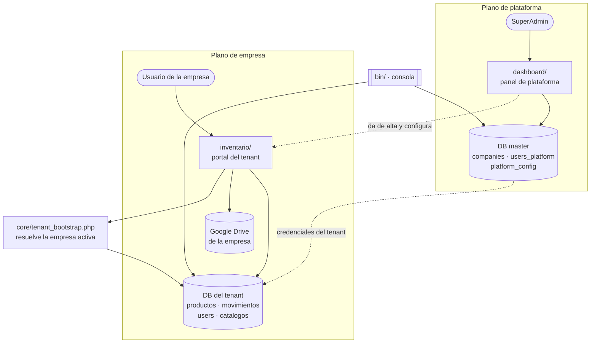
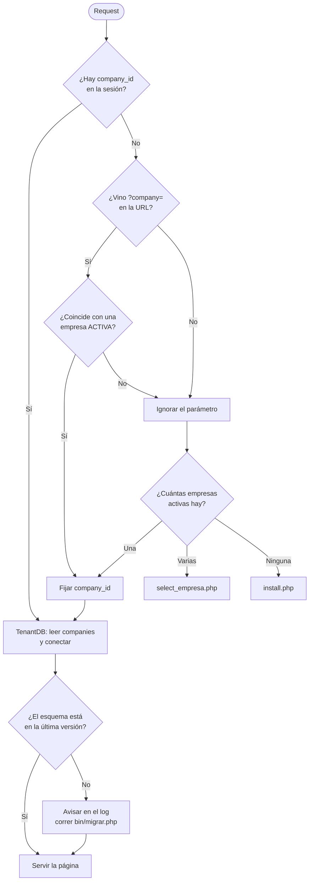
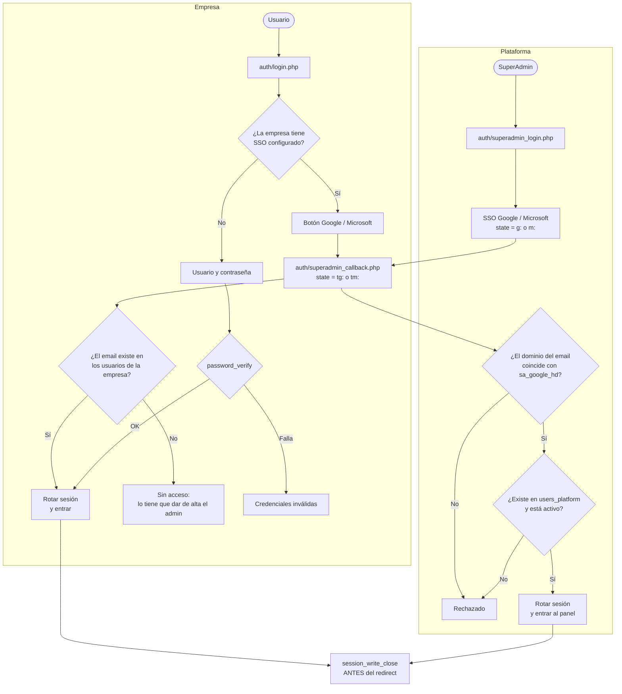
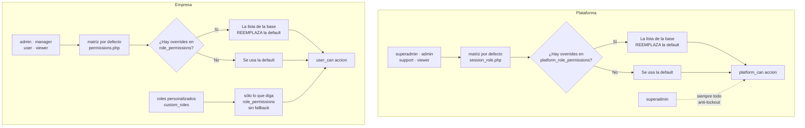
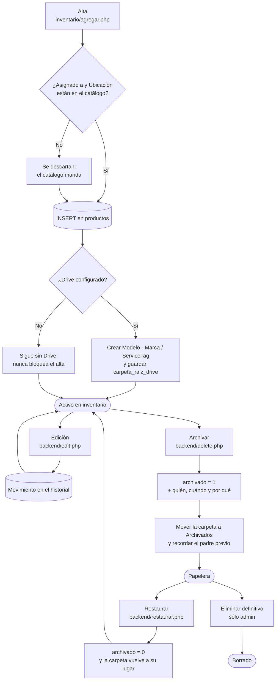
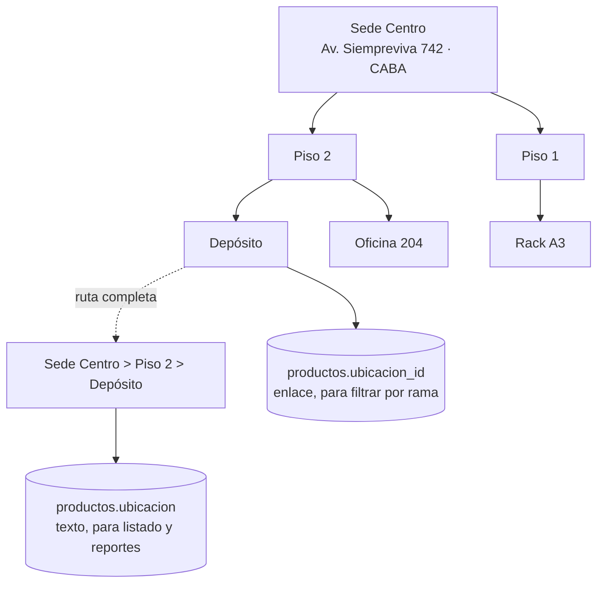
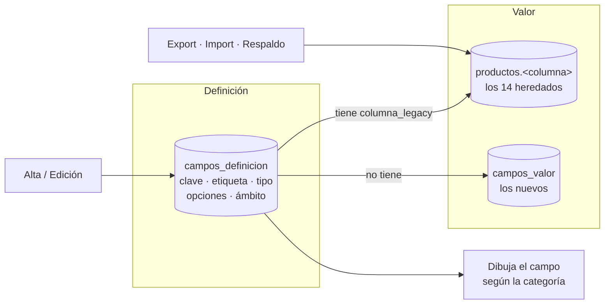
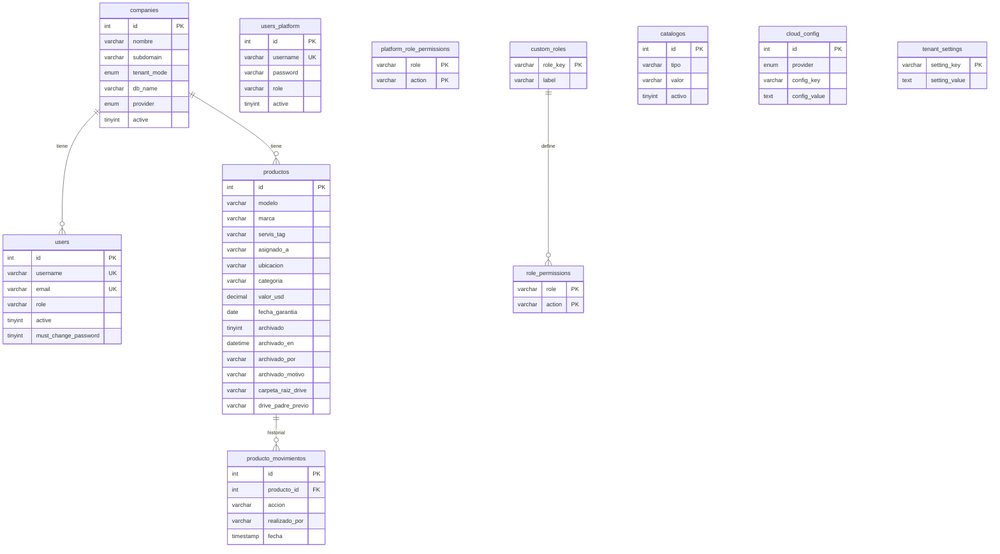
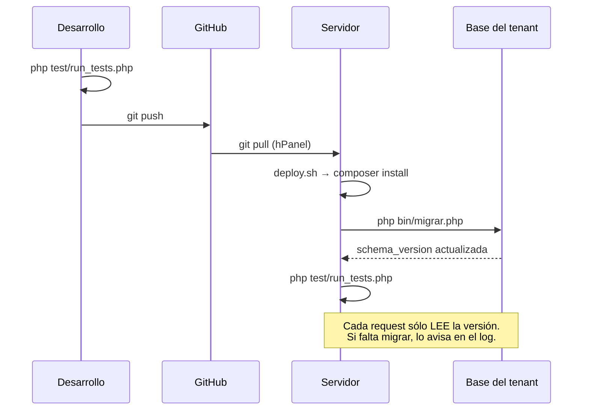

# Asset Vault — Documento maestro

Documento de referencia del proyecto: qué hace, cómo está armado, por qué cada pieza está
donde está, y qué decisiones se tomaron y a cuenta de qué.

`README.md` refleja este documento **1:1**, diagramas incluidos. Si algo cambia acá, cambia
allá en el mismo commit; la batería de regresión lo verifica.

---

## Índice

1. [Qué es](#1-qué-es)
2. [Arquitectura del sistema](#2-arquitectura-del-sistema)
3. [Multiempresa: cómo se resuelve la empresa](#3-multiempresa-cómo-se-resuelve-la-empresa)
4. [Autenticación](#4-autenticación)
5. [Permisos](#5-permisos)
6. [Ciclo de vida de un activo](#6-ciclo-de-vida-de-un-activo)
7. [Catálogos](#7-catálogos)
8. [Papelera](#8-papelera)
9. [Integración con Google Drive](#9-integración-con-google-drive)
10. [Modelo de datos](#10-modelo-de-datos)
11. [Esquema versionado y despliegue](#11-esquema-versionado-y-despliegue)
12. [Sistema de diseño](#12-sistema-de-diseño)
13. [Seguridad](#13-seguridad)
14. [Batería de regresión](#14-batería-de-regresión)
15. [Decisiones y su motivo](#15-decisiones-y-su-motivo)

---

## 1. Qué es

**Asset Vault** es una plataforma SaaS multiempresa de inventario de activos de IT. Cada
empresa cliente tiene su propio portal, sus usuarios, sus roles, su base de datos y su
Google Drive; una capa de plataforma por encima administra las empresas.

Reemplaza la planilla de cálculo compartida por una aplicación con historial, control de
acceso por rol, respaldo documental en Drive y reportes.

Está en producción en `https://desarrollo.intellihelp.tech`, con INTELLIHELP S.A. como
primera empresa (subdominio `ITH`).

**Qué resuelve**

- Un registro único de activos con su responsable, ubicación, garantía, valor y estado.
- Historial completo: qué cambió, quién lo cambió y cuándo.
- Documentación adjunta (remitos, facturas, fotos) respaldada en Drive, ordenada por activo.
- Baja reversible: un activo dado de baja por error se restaura desde la papelera.
- Reportes por categoría, ubicación, responsable, garantía y valor.

---

## 2. Arquitectura del sistema

PHP 8.2 plano, sin framework. Dos planos con bases separadas.



**Plano de plataforma** — base `master`. Da de alta empresas, gestiona los usuarios de
plataforma y la configuración global. Entrada: `auth/superadmin_login.php` → `dashboard/`.

**Plano de empresa (tenant)** — una base por empresa. Es el inventario propiamente dicho.
Entrada: `auth/login.php?company=<subdominio>` → `inventario/`.

Los dos planos **no comparten sesión**: el flag `is_superadmin` y `user_id` son excluyentes,
y cada portal redirige al otro si detecta la sesión equivocada.

### Estructura de directorios

```
assets/css/app.css          sistema de diseño del portal tenant
assets/css/intellihelp.css  sistema de diseño del panel superadmin
auth/                       login local, SSO Google/Microsoft, logout, cambio de contraseña
backend/                    endpoints: alta, edición, archivado, restaurar, import/export, CSRF
bin/                        consola: migrar, resets, alta de superadmin
core/config/                configuración de plataforma y carga de secretos
core/db/                    conexiones master y tenant, migraciones versionadas
core/integraciones/         cliente y helpers de Google Drive
core/security/              permisos, sesión, CSRF
core/tenants/               instalación de esquema, settings y catálogos por empresa
dashboard/                  panel superadmin
includes/                   layout compartido, iconos, campo de catálogo
inventario/                 portal del tenant
md/                         este documento y los requerimientos
secure/                     secretos y temporales — nunca por HTTP
test/                       batería de regresión
```

---

## 3. Multiempresa: cómo se resuelve la empresa

Una empresa puede vivir de dos maneras:

| Modo | Dónde viven sus tablas | Cuándo se usa |
| --- | --- | --- |
| `external` | base de datos propia, tablas sin prefijo | el caso normal: aislamiento real entre clientes |
| `prefix` | dentro de la master, tablas `t{id}_…` | cuando el hosting no permite crear más bases |

`core/db/TenantDB.php` lee de `companies` los datos de conexión y devuelve la conexión y el
helper `tn('tabla')`, que en modo `prefix` antepone el prefijo y en `external` devuelve el
nombre tal cual. Todo el código de la aplicación usa `tn()`, así que es indiferente al modo.



El `company_id` se valida **siempre** contra la lista de empresas activas, tanto si viene por
querystring como si viene por POST.

### La identidad y la empresa viajan juntas

`user_id` es el id de una fila en la tabla `users` **de una empresa**: el usuario 1 de una
empresa y el usuario 1 de otra son dos personas distintas. Por eso no basta con validar que el
`company_id` exista y esté activo —hay que validar que le corresponda a quien está logueado.

- Al autenticar se graba `auth_company_id`, la empresa contra la que se validó la credencial.
- `backend/db.php` la compara con `company_id` **en cada request**. Si no coinciden, destruye
  la sesión y manda al login.
- Elegir empresa descarta la autenticación entera y manda al login de esa empresa. "Tener
  acceso a dos empresas" son dos cuentas distintas, no una que viaja.

> Esto cierra una escalada de privilegios real: `select_empresa.php` fijaba `company_id` sin
> tocar `user_id`, así que el `SELECT ... WHERE id = $user_id` de la página siguiente devolvía
> a otra persona —con su rol— en el tenant nuevo. **La verificación es central y no en los
> puntos de entrada, porque cualquier código que escriba `company_id` reabriría el agujero.**

---

## 4. Autenticación

Tres caminos, todos con rotación del ID de sesión al autenticar.



El `session_write_close()` antes del redirect no es un detalle: en hosting compartido, si el
`Location` sale primero, el request siguiente puede leer la sesión todavía vacía. Ese síntoma
se le había atribuido a `session_regenerate_id()`, y por eso la rotación estaba desactivada
—lo que dejaba la puerta abierta a la fijación de sesión.

Una empresa con SSO puede **deshabilitar el login local** (`disable_local_login`), forzando
que todos los accesos pasen por el proveedor.

---

## 5. Permisos

Dos matrices independientes, cada una con overrides por base de datos.



### Acciones del tenant

| Acción | admin | manager | user | viewer |
| --- | :-: | :-: | :-: | :-: |
| `asset.view` | ✓ | ✓ | ✓ | ✓ |
| `asset.create` | ✓ | ✓ | ✓ | |
| `asset.edit` | ✓ | ✓ | ✓ | |
| `asset.archive` | ✓ | ✓ | | |
| `asset.trash.view` | ✓ | ✓ | | |
| `asset.restore` | ✓ | ✓ | | |
| `asset.delete` | ✓ | | | |
| `asset.export` | ✓ | ✓ | | |
| `asset.import_csv` | ✓ | ✓ | | |
| `asset.backup_full` | ✓ | | | |
| `report.view` | ✓ | ✓ | ✓ | ✓ |
| `catalog.manage` | ✓ | | | |
| `user.view` / `user.create` / `user.edit` / `user.delete` | ✓ | | | |
| `integration.view` / `integration.edit` | ✓ | | | |
| `self.change_password` | ✓ | ✓ | ✓ | ✓ |

### Acciones de plataforma

| Acción | superadmin | admin | support | viewer |
| --- | :-: | :-: | :-: | :-: |
| `company.view` | ✓ | ✓ | ✓ | ✓ |
| `company.create` / `company.edit` | ✓ | ✓ | | |
| `company.delete` | ✓ | | | |
| `company.backup` | ✓ | | | |
| `tenant_user.view` | ✓ | ✓ | ✓ | |
| `tenant_user.manage` | ✓ | ✓ | | |
| `platform_user.manage` | ✓ | | | |
| `integrations.manage` | ✓ | | | |
| `logs.view` | ✓ | ✓ | | |

`company.backup` está separado de `company.view` a propósito: el respaldo incluye los hashes
de contraseña y el `client_secret` de OAuth de la empresa, así que no puede depender de un
permiso que tiene hasta el rol de sólo lectura.

**Roles personalizados**: cada empresa puede crear los suyos (`custom_roles`). A diferencia de
los cuatro incorporados, un rol personalizado **no hereda nada**: sólo tiene lo que esté
explícitamente en `role_permissions`.

---

## 6. Ciclo de vida de un activo



Cada cambio deja una fila en `producto_movimientos` con el estado completo del activo en ese
momento: el historial no depende de reconstruir nada.

### El alta carga todo de una

Dar de alta una computadora era crear el activo y después ir a la ficha a cargar
componentes, red, relaciones, contratos, documentos y notas: dos pantallas y
ocho formularios, cada uno con su propio envío — cargabas un disco, se recargaba
la página, cargabas la memoria, se recargaba otra vez.

Ahora todo eso está en el formulario de alta y entra en el mismo POST. Las filas
de componentes y de interfaces se agregan y se quitan sin recargar, porque no se
sabe cuántas hay: una notebook tiene un disco, un servidor tiene seis, un switch
tiene veinticuatro puertos.

Una fila que no se puede guardar **no aborta el alta**: se anota el motivo y se
sigue, y el aviso de llegada dice con números qué entró —«Se guardaron 2
componentes, 1 puerto de red, 1 dirección IP y 1 nota»—. Perder los quince
campos que estaban bien porque una MAC estaba mal escrita es peor que guardar
catorce y decir cuál falló.

Lo guarda [`core/tenants/ficha_alta.php`](core/tenants/ficha_alta.php) y lo
dibuja [`includes/campos_ficha.php`](includes/campos_ficha.php).

### Versión y Edición salen de una lista

Los dos desplegables estaban vacíos, con el cartel «La lista está vacía. Cargá
los valores en Listas desplegables». Para anotar «Windows 11 · 24H2 · Pro» había
que ir a otra pantalla, dar de alta «24H2», dar de alta «Pro» y volver. Nadie
hace eso: escribe cualquier cosa o deja el campo en blanco, y la pregunta que
motivó todo el módulo —cuántas máquinas siguen en una versión sin soporte—
vuelve a no poder contestarse.

Ahora se elige el sistema y las dos listas pasan a ser las de ese sistema:

| Sistema | Versiones que trae |
| --- | --- |
| Windows 11 | 25H2, 24H2, 23H2, 22H2, 21H2 |
| Windows 10 | 22H2 … 1507, las catorce |
| Ubuntu | 25.04, 24.10, 24.04 LTS … 16.04 LTS |
| Debian | 13 (Trixie) … 9 (Stretch) |
| macOS | 26 (Tahoe) … 10.14 (Mojave) |
| VMware ESXi | 8.0, 7.0, 6.7, 6.5 |

Son 63 sistemas con 210 versiones y 98 ediciones, en
[`core/tenants/so_versiones.php`](core/tenants/so_versiones.php).

**Está en el código y no en la base** porque no es un dato de la empresa: que
Windows 11 tenga 24H2 no depende de qué inventario sea. Ponerlo en `catalogos`
obligaría a sembrar mil filas en cada empresa nueva y a migrar cada vez que sale
una versión.

**La lista llega hasta lo que se puede afirmar.** Una lista de versiones
inventadas es peor que una corta: alguien elige una de un desplegable, la da por
buena, y queda un inventario con un dato que no existe. Lo que falte se agrega
con el botón `+` sin salir de la pantalla, se guarda en el catálogo de la
empresa y queda disponible para siempre.

### Volver a donde se estaba

Se entraba a editar un activo desde el listado, se cancelaba, y la edición
devolvía **siempre** al detalle del activo — una pantalla por la que nadie había
pasado. «Cancelar» tiene que deshacer el paso, no llevar a un lugar nuevo.

Cada pantalla de ida y vuelta recibe de dónde vino en `?volver=` y usa eso para
su «Cancelar» y su «Volver», conservando la página y los filtros que había. Una
cadena de tres pantallas —listado → detalle → edición— vuelve al listado y no al
detalle.

No se usa `HTTP_REFERER`: no llega siempre y lo manda el cliente. El destino se
valida contra una lista de secciones conocidas, con el camino ya resuelto — un
`?volver=//otro-sitio.com` es una redirección abierta y el navegador lo trata
como otro dominio. Está en [`includes/volver.php`](includes/volver.php).

---

## 7. Catálogos

"Asignado a" y "Ubicación" eran campos de texto libre. El resultado previsible: "Depósito",
"deposito", "Dep." y "DEPOSITO" conviviendo, y los reportes por ubicación o por responsable
sin agrupar nada.

Ahora son listas gestionadas (`catalogos`):

- **El admin las mantiene** en `inventario/catalogos.php`: alta, renombrar, baja lógica,
  eliminar. También puede agregar un valor sin salir del formulario de alta/edición, con el
  botón `+` al lado del desplegable.
- **Un usuario común elige de la lista**, no la amplía. Permiso `catalog.manage`.
- **Renombrar arrastra el cambio** a los activos que usaban ese valor, para que no queden
  apuntando a un texto que ya no existe.
- **Eliminar se rechaza** si hay activos usando el valor; en su lugar se da de baja, y el
  valor sale del desplegable sin tocar los activos históricos.
- **La validación es del lado del servidor.** El `<select>` es comodidad visual: quien mande
  otro valor por POST recibe un campo vacío. Se acepta el valor que el activo ya tenía, para
  no romper la edición de activos cargados antes del catálogo o importados por CSV.
- Al migrar, el catálogo **se sembró con los valores que ya existían**, así no se perdió nada.


### Ubicaciones: un árbol, no una lista

"Ubicación" era un valor suelto. La sede, el piso y el depósito eran tres textos sin relación
entre sí, así que no había forma de preguntar *qué hay en la Sede Centro*. Ahora es un árbol,
y cada nodo lleva sus datos de dirección.



- **Renombrar arrastra todo.** Cambiar "Sede Centro" recalcula la ruta de cada descendiente y
  la propaga a los activos; ninguno queda apuntando a una ruta que ya no existe.
- **Un nodo no puede colgar de un descendiente suyo**, y no se borra una ubicación que tenga
  hijos o activos.
- **Cada nodo tiene dirección**: calle, código postal, localidad, provincia, país, edificio,
  habitación y coordenadas.
- `productos.ubicacion` sigue guardando la **ruta completa como texto**, así que el listado,
  los filtros, los reportes, el CSV y el respaldo no cambiaron.

### Campos específicos por categoría

Un patchcord tiene longitud y tipo; una bobina, categoría de cable; una cinta, generación LTO.
Eso vivía como **catorce columnas** en la tabla de activos, así que sumar una categoría era
cambiar el esquema y tocar trece archivos.



- **Agregar un campo es una fila**, desde *Campos*. No hay migración ni DDL.
- **Los catorce heredados siguen en su columna.** Por eso las exportaciones, las importaciones
  y el respaldo no cambiaron, y por eso esta migración no mueve ni un dato.
- **La validación es del servidor**: un valor que no está en las opciones se descarta, aunque el
  `<select>` lo haya ofrecido.
- Un campo con valores cargados no se puede eliminar; se oculta y los activos lo conservan.

Retirar las catorce columnas es el paso siguiente, cuando esto esté probado en producción.
Agregar la forma nueva y sacar la vieja en un mismo movimiento es como se pierden datos.

### Información financiera y administrativa

Lo que GLPI llama *Infocom* vive en su propia tabla, una fila por activo: número de pedido,
remito, factura y número contable; proveedor y presupuesto; fechas de orden, entrega, puesta en
servicio, último inventario físico y decomiso; datos y valor de extensión de garantía;
criticidad de negocio.

**La amortización es por activo** —duración, tipo y coeficiente—. Antes el reporte calculaba
con un valor del querystring, el mismo para todos, porque no había dónde guardarla.

Los seis campos que ya existían en `productos` (valor, cantidad, fecha de compra, fecha y
período de garantía, fecha de baja) **se quedan ahí**: la tabla nueva no duplica ninguno. Dos
fuentes para el mismo dato terminan siempre en que no coinciden.


---

## 8. Papelera

Archivar era un camino de ida: el activo desaparecía del listado y la única salida era
editarlo a mano y destildar `archivado`; la carpeta quedaba en Drive con el prefijo
`[ARCHIVADO]` para siempre.

`inventario/archivados.php` muestra los archivados con **quién, cuándo y por qué**, con
buscador y paginado. Restaurar:

1. devuelve el activo al inventario (`archivado = 0` y se limpian los campos de baja);
2. deja un movimiento `Restaurado` en el historial, citando el motivo original;
3. mueve la carpeta de Drive de vuelta a donde estaba y le saca el prefijo del nombre.

Ver la papelera pide `asset.trash.view`; restaurar, `asset.restore`. Ninguno de los dos lo
tiene un rol de sólo lectura.

### Eliminar definitivamente

La papelera también se vacía. `asset.delete` estuvo mucho tiempo en la lista de permisos sin
que ninguna pantalla lo consultara: se podía tildar y no hacía nada. Ahora elimina de verdad,
con tres condiciones:

1. **Sólo lo archivado.** Desde el listado principal no se llega: primero se archiva (que se
   deshace) y después se elimina (que no). No hay un botón que destruya algo de un clic.
2. **Hay que escribir el número del activo.** Un «¿está seguro?» se acepta sin leerlo; copiar
   un número obliga a mirar cuál. Lo pide el diálogo del sistema y el servidor lo vuelve a
   verificar, por si alguien postea el formulario a mano.
3. **El historial sobrevive.** Queda una fila `Eliminado` con el modelo, la marca, el service
   tag y quién lo borró. Si mañana aparece una auditoría de bienes, la respuesta no puede ser
   «no sé, alguien lo borró».

La carpeta de Drive **no** se toca: queda en «Archivados», y el mensaje de vuelta lo aclara.

Lo que cuelga del activo —sistema operativo, componentes, puertos de red con sus direcciones,
notas, campos propios, vínculos con contratos y documentos, relaciones con otros activos— se
borra en cascada. Como el esquema no tiene claves foráneas, esa lista está escrita a mano en
[`core/tenants/papelera.php`](core/tenants/papelera.php), en un solo lugar, y la batería de
integración la compara contra las tablas que el esquema realmente tiene: si alguien agrega una
tabla con `producto_id` y se olvida de sumarla, el test falla.

Eliminar pide `asset.delete`, que por defecto sólo tiene el administrador.

---

## 9. Integración con Google Drive

Cada empresa conecta su propio Drive. La estructura que arma la aplicación:

```
<root_folder_id de la empresa>
├── Modelo - Marca/
│   └── ServiceTag (o activo_<id>)/
│       ├── remito.pdf
│       └── foto.jpg
└── Archivados/
    └── [ARCHIVADO 2026-08-04] ServiceTag/
```

- El cliente de Drive vive en `core/integraciones/drive.php`. Antes ese bootstrap estaba
  copiado en cinco archivos con variantes distintas.
- **Drive nunca bloquea el inventario.** Si no está configurado, si el token venció o si la
  API falla, la operación en la base ya se hizo y sólo se registra un aviso en el log.
- Los archivos se validan por MIME real y tamaño (5 MB). Si el nombre ya existe en la carpeta,
  se abre el flujo de confirmación (sobrescribir / renombrar), y el temporal se guarda **fuera
  del web root** con nombre aleatorio y sin la extensión del usuario.
- Los nombres se escapan antes de entrar en la query `q` de la API.

---

## 10. Modelo de datos



`producto_movimientos` guarda una copia del activo en cada cambio: es un historial de estados,
no de diferencias. Ocupa más, pero sobrevive a cualquier cambio de esquema posterior.

### Índices

`productos` no tenía **ningún** índice fuera de la clave primaria, así que cada filtro del
listado y de los reportes era un recorrido completo de la tabla. La migración 2 agrega:

- `productos`: `archivado`, `categoria`, `estado`, `servis_tag`, `asignado_a`, `ubicacion`,
  `fecha_garantia`, `(archivado, categoria)`, `archivado_en`
- `producto_movimientos`: `fecha`, `accion`, `(producto_id, fecha)`

---

## 11. Esquema versionado y despliegue



El DDL corría **en cada request**: `backend/db.php` hacía `SHOW TABLES`, dos
`ALTER TABLE … ADD COLUMN IF NOT EXISTS` y un `SHOW COLUMNS`, y varios módulos lanzaban
`CREATE TABLE IF NOT EXISTS`. Eran cinco o más consultas de metadata antes de la primera
consulta útil de cada página, y una de ellas llegó a revertir la columna `role` a `ENUM`,
rompiendo los roles personalizados.

Ahora el esquema está versionado en `core/db/migraciones.php` y se aplica una sola vez con
`php bin/migrar.php`. Para cambiar el esquema se **agrega** una migración al final; nunca se
edita una ya aplicada.

| Versión | Qué hace |
| --- | --- |
| 1 | Estado base idempotente: tablas de settings, roles y permisos; `role` a `VARCHAR` |
| 2 | Índices de `productos` y `producto_movimientos` |
| 3 | Tabla `catalogos` + siembra desde los valores existentes |
| 4 | Columnas de papelera y `drive_padre_previo` |
| 5 | Unifica la collation de `tenant_settings` con la de la base |

---

## 12. Sistema de diseño

El portal del tenant usa **exactamente** los mismos tokens que el CRM y APP Tickets, para que
las tres aplicaciones se vean como una sola familia.

| Token | Valor | Uso |
| --- | --- | --- |
| `--ink` | `#161922` | texto y neutros |
| `--muted` | `#6f6a7d` | texto secundario |
| `--line` | `#e7e4ef` | bordes |
| `--surface` | `#ffffff` | tarjetas, campos |
| `--bg` | `#f6f5fa` | fondo de la aplicación |
| `--primary` | `#663399` | color de marca |
| `--primary-700` | `#522a7a` | hover del primario |
| `--accent` | `#9CC930` | **sólo positivos** |
| `--danger` | `#a12a1e` | errores |
| `--warn` | `#a8620a` | advertencias |
| `--font` | `Saira` | tipografía |
| `--radius` | `15px` / `10px` / `9px` | radios |

- **Shell**: topbar con la marca y las acciones, y debajo una fila de pestañas. La misma
  silueta que el CRM y Tickets.
- **El acento verde es sólo para positivos.** No hay un color de "éxito" que compita con él.
- Saira se carga con `<link>` en el `<head>`, no con `@import` dentro del CSS —que obliga al
  navegador a bajar y parsear la hoja entera antes de descubrir la fuente.
- Los assets se versionan con la fecha de modificación del CSS, para que un cambio no lo tape
  la caché del navegador ni la del CDN.
- **El panel superadmin conserva su diseño** (`assets/css/intellihelp.css`). `head.php` elige
  la hoja según el portal.

Las clases del markup siguen llamándose `ih-*`: el cambio de piel no obligó a reescribir
ninguna pantalla.

### Tres hojas, y ninguna regla escrita en una pantalla

```
assets/css/app.css          los tokens y los componentes del portal del cliente
assets/css/intellihelp.css  los tokens y los componentes del panel de superadmin
assets/css/componentes.css  lo que usan LAS DOS, cargada por las dos
```

Ninguna pantalla del portal del cliente define estilos propios: ni un bloque `<style>` ni un
atributo `style`. Las dos excepciones están permitidas explícitamente y una prueba las nombra:
un dato que sólo el PHP conoce —el nivel de sangría de un árbol, que viaja como `--nivel`— y el
color de un logo ajeno, que pintado de violeta deja de ser el logo.

No es prolijidad. Son dos problemas concretos:

1. **Una regla escrita en una pantalla no la ve ninguna otra**, así que el mismo componente
   termina con dos formas. Pasó con el paginador —tres versiones, una de ellas dibujaba un botón
   por página—, con las pastillas de rol —dos, una por portal, con valores distintos— y con el
   rótulo de sección —tres, con tres nombres distintos—.
2. **La hoja de la página carga después de la del sistema**, así que le gana sin pedir permiso.
   El listado tenía un `<style>` que repintaba `.ih-flash` con `#16a34a`: en la misma pantalla
   convivían dos verdes.

Y hay una tercera, propia de este proyecto: `backend/view_details.php` y `backend/edit.php` son
pantallas **compartidas** por los dos portales —la cabecera elige la hoja según la sesión—, así
que una regla definida ahí se apoyaba en tokens que cada portal resuelve distinto.

### Los componentes compartidos

`componentes.css` nació para los controles que el navegador dibuja por su cuenta y ninguna regla
alcanza: la lista de un `<select>`, el calendario de un `input[type=date]`, el cuadro de
`confirm()`. Hoy tiene además todo lo que dos pantallas necesitaban igual:

| Qué | Para qué |
| --- | --- |
| `.ih-pager` | el paginador, con el rango acotado y el «mostrando X–Y de Z» |
| `.ih-barra` | título de sección con sus botones, que en pantalla angosta bajan y se ensanchan |
| `.ih-pills` / `.ih-pill` | elegir entre cosas del mismo tipo sin salir de la pantalla |
| `.ih-permisos` | la lista de permisos de un rol |
| `.ih-opciones` / `.ih-opcion` | dos o tres acciones con su explicación y su botón |
| `.ih-foco` | la pantalla de una sola decisión: archivar, confirmar, el resultado |
| `.ih-caminos` / `.ih-camino` | dos salidas entre las que elegir, una al lado de la otra |
| `.ih-datos` / `.ih-dato` | etiqueta a la izquierda, valor a la derecha |
| `.ih-seccion__titulo` | el rótulo que parte una pantalla larga en bloques |
| `.ih-buscador` | el campo de búsqueda del encabezado, con o sin lupa adentro |
| `.ih-pasos` | instrucciones en orden |
| `.ih-nota` | lo que una persona escribió sobre un activo |
| `.ih-resumen` | la cajita que resume lo que ya está configurado |
| `.ih-etiquetas` | una lista de nombres — que no es lo mismo que una insignia |
| `.ih-alert--accion` | un aviso que trae el botón que lo resuelve |
| `.ih-menu` | un menú que cuelga de un botón |

Las utilidades de disposición —filas, separaciones, márgenes— también viven ahí. Estaban en las
dos hojas de portal y **con distinto alcance**: `app.css` tenía la escala de márgenes de 1 a 6 y
el panel sólo los pares, así que una pantalla compartida usaba clases que en el panel no existen.
Los tamaños de texto y los colores siguen viniendo de cada portal, porque todavía difieren.

### Esconder algo: siempre `hidden`

`componentes.css` declara `[hidden] { display: none !important }`, así que **mezclar `hidden` con
`style.display` rompe**: un `style.display = ''` no limpia el atributo y el bloque no vuelve a
aparecer. Todo el portal usa `hidden`, en el HTML y en el JavaScript — los campos por categoría
del alta y de la edición, los paneles de reportes y de integraciones, el selector de columnas del
listado.

### La deuda del panel, medida

`php test/tokens.php` compara los tokens que usa la hoja compartida resueltos en cada portal.
Difieren 36: nueve a propósito —los `--ih-ctl-*`, porque los controles del panel son más
compactos— y veintisiete que son deuda. El panel todavía corre con la escala de grises de
Tailwind y con `--ih-success: #16a34a`, que es justo el verde ajeno que hubo que sacar de las
pantallas del cliente. Cada diferencia está anotada una por una, y la batería **no exige que la
deuda esté pagada: exige que no crezca**.


---

## 13. Seguridad

Ver `SECURITY.md` para el detalle. Resumen de los controles:

| Control | Dónde |
| --- | --- |
| Secretos fuera del repositorio | `secure/config/secrets.php` (gitignored, `600`, 403 por HTTP) |
| Herramientas destructivas sólo por consola | `bin/` + `.htaccess` + guard de SAPI + `ASSET_VAULT_DEV` |
| Alta de superadmin por consola con contraseña aleatoria | `bin/crear_superadmin.php` |
| Rotación del ID de sesión al autenticar | `core/security/session_guard.php` |
| Cookie `Secure` + `HttpOnly` + `SameSite` + `use_strict_mode` | `.user.ini` y `session_guard.php` |
| CSRF por acción, con TTL y rotación | `backend/csrf.php` |
| Sentencias preparadas en todo el acceso a datos | todo el código |
| Validación de catálogos del lado del servidor | `catalogo_normalizar()` |
| Uploads fuera del web root, sin la extensión del usuario | `secure/tmp/` |
| Escapado de las queries `q` de Drive | `drive_q()` |
| Cabeceras de seguridad y directorios bloqueados | `.htaccess` |
| Auditoría | `logs/audit.log` (no accesible por HTTP) |

---

## 14. Batería de regresión

Seis baterías. La primera corre sola, sin base ni servidor, y es la que se usa a cada rato:

```bash
php test/run_tests.php            # 405 chequeos — análisis estático del árbol
php test/run_tests.php seguridad  # un grupo

php test/ortografia.php           # faltas de ortografía y vocabulario en el texto visible
php test/ayudas.php               # campos de formulario sin un ejemplo que guíe
php test/colores.php              # colores escritos a mano fuera de la identidad visual
php test/tokens.php               # tokens que valen distinto en cada portal

node test/componentes.js          # 147 chequeos — los componentes, ejecutados en jsdom

AV_TEST_DB_HOST=127.0.0.1 AV_TEST_DB_PORT=3307 AV_TEST_DB_USER=root AV_TEST_DB_NAME=av_tenant php test/integracion.php          # 260 chequeos — contra una base descartable
```

`run_tests.php` corre **sin base de datos ni servidor**: es análisis estático sobre el árbol
del repositorio, así que funciona igual en la máquina de desarrollo, en el servidor y en CI.
Incluye a las cuatro del medio, así que correrla sola ya las cubre; se invocan aparte cuando
hace falta ver *cuáles* son los hallazgos y no sólo que hay.

| Grupo | Qué verifica |
| --- | --- |
| SINTAXIS | que todos los `.php` parseen |
| CODIGO · bind_param | que los tipos coincidan con la cantidad de parámetros |
| CODIGO · Drive | que nadie indexe un `Google\Collection` ni interpole en `q` |
| SEGURIDAD · destructivas | que no haya resets en el web root ni gates por hostname |
| SEGURIDAD · secretos | que no haya credenciales versionadas ni auto-seed de superadmin |
| SEGURIDAD · sesión | rotación del ID y flags de la cookie |
| SEGURIDAD · exposición | directorios bloqueados, cabeceras, permisos del panel |
| CATALOGOS | validación del lado servidor y permiso de gestión |
| PAPELERA | permisos, CSRF, historial y movimiento de la carpeta |
| ESQUEMA | migraciones consecutivas y sin DDL por request |
| DISENO | tokens idénticos a CMR/Tickets, ninguna clase sin estilo, ninguna pantalla del cliente con estilos propios, el acento verde sólo en botones que guardan |
| ORTOGRAFIA | faltas y vocabulario en el texto que la persona lee |
| FORMULARIOS | que ningún campo quede sin un ejemplo |
| DOCUMENTACION | que este documento y el README estén al día y 1:1 |
| REPOSITORIO | `.gitattributes`, `composer.lock`, ignorados, ningún byte de control |

`integracion.php` trabaja sobre una base **descartable**: al empezar borra las tablas del
esquema que se le indique, y aborta si encuentra activos cargados. Además se lee a sí misma y
aborta si alguna consulta nombra una tabla sin prefijar — pasó una vez, y tres activos de
prueba terminaron en el inventario de desarrollo.

**Regla del proyecto: cada defecto detectado incorpora un test.** Los grupos SEGURIDAD y
CODIGO son, casi uno a uno, los agujeros y los bugs que ya aparecieron. Vale también para los
auditores: cuando uno de ellos resultó estar midiendo mal —un comentario de JavaScript contado
como campo de formulario, la cola de un atributo leída como prosa— lo que se arregló fue el
auditor, y el motivo quedó escrito al lado.

---

## 15. Decisiones y su motivo

**Por qué las herramientas destructivas salieron del web root.**
`bay.php` y `reset_inventario_ith.php` se autorizaban con
`str_starts_with($host, 'desarrollo.')`. El host de producción **es**
`desarrollo.intellihelp.tech`, así que el chequeo daba verdadero para cualquiera: un `POST`
sin sesión ni CSRF hacía `DROP TABLE` de todas las tablas de todos los tenants. Encadenado
con el auto-seed de superadmin de una página pública, permitía tomar la plataforma entera sin
credenciales. La conclusión no fue "arreglar el `if`": una herramienta destructiva no se
protege con una condición, se saca del alcance del servidor web.

**Por qué los tipos de `bind_param` se derivan y no se escriben.**
`edit.php` declaraba 33 caracteres de tipos para 32 parámetros —el comentario de al lado
incluso decía "32 chars"—. En PHP 8 eso lanza `ArgumentCountError`, que nadie atrapa: error
fatal y HTTP 500 al guardar cualquier edición. El mismo defecto estaba en `import_csv.php` y
rompía la importación. Contando a mano vuelve a pasar; derivándolos de la lista de columnas,
no.

**Por qué el ID de sesión se rota.**
No se rotaba, con este comentario: *"session_regenerate_id(true) en algunos hostings shared
envía cookie con nuevo ID pero no escribe el archivo"*. El síntoma era real, pero la causa no
era la regeneración: era que el `Location` salía antes de que PHP escribiera la sesión. Se
verificó en el hosting real que rotando y cerrando la sesión antes del redirect todo funciona.
Sin rotación, con `use_strict_mode` apagado y un WordPress en el dominio padre, un atacante
podía fijar un `PHPSESSID` y quedarse con la sesión del usuario.

**Por qué el historial guarda el estado completo y no las diferencias.**
Ocupa más, pero un historial de diferencias depende de poder reconstruir el estado, y eso se
rompe con el primer cambio de esquema. Un activo dado de baja en 2024 se puede leer tal como
estaba sin depender del esquema de hoy.

**Por qué Drive nunca bloquea.**
El inventario tiene que funcionar aunque Drive no esté configurado, el token haya vencido o
la API responda mal. Toda la integración devuelve `null` en vez de lanzar excepción, y la
operación en la base se hace igual.

**Por qué las clases siguen llamándose `ih-`.**
Cambiar la piel para que hable el mismo idioma que el CRM y Tickets no requería tocar el
markup. Reescribir las clases en 30 archivos habría sido un cambio enorme con riesgo alto y
cero beneficio funcional.
